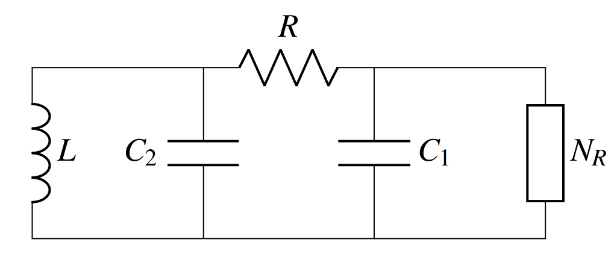
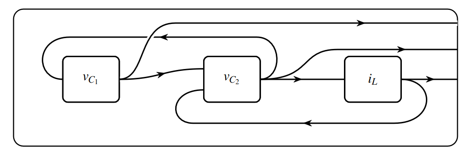
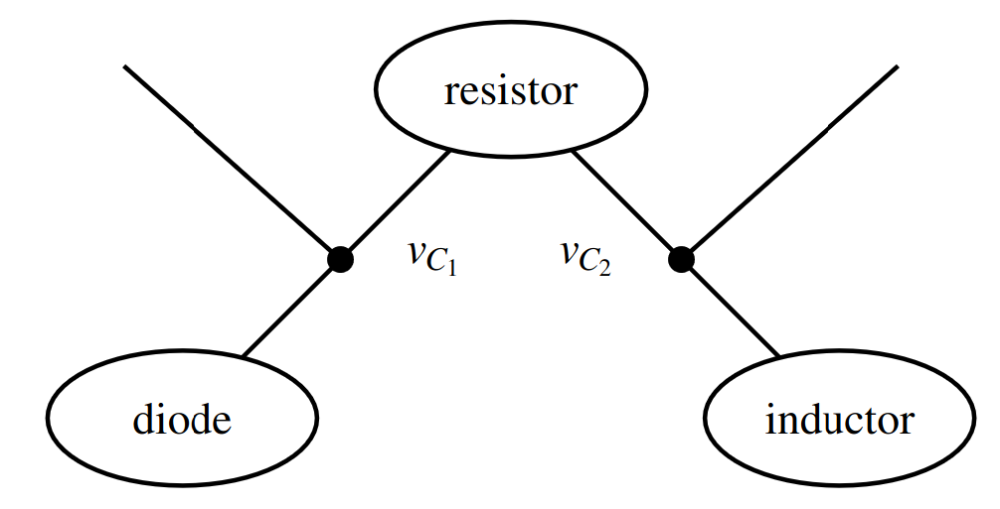
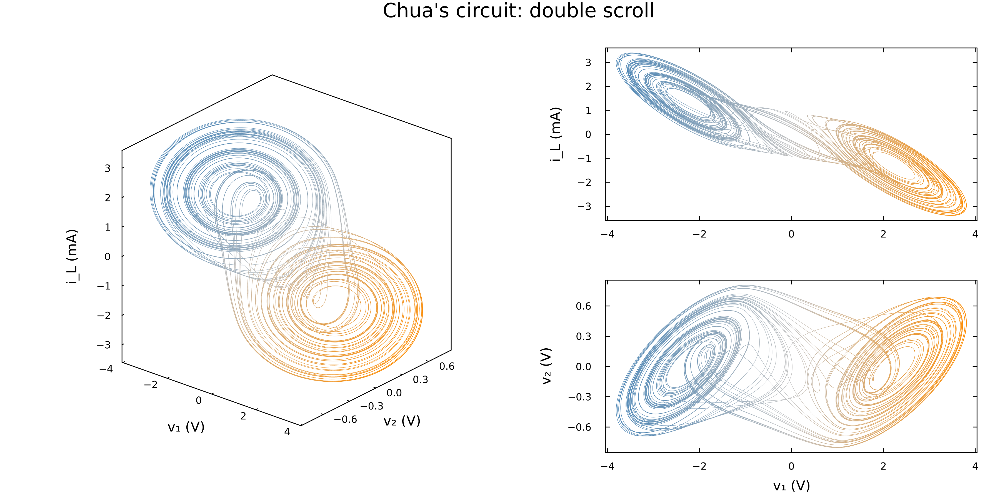
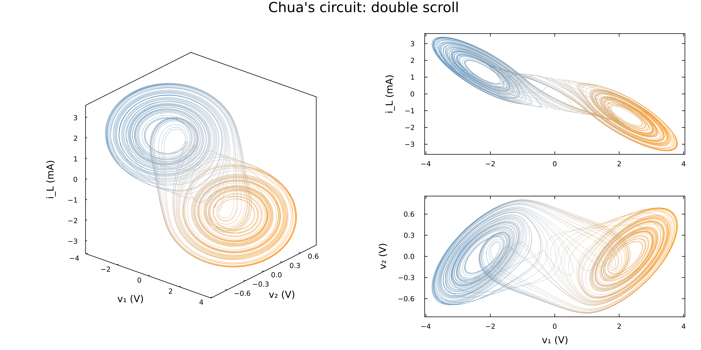
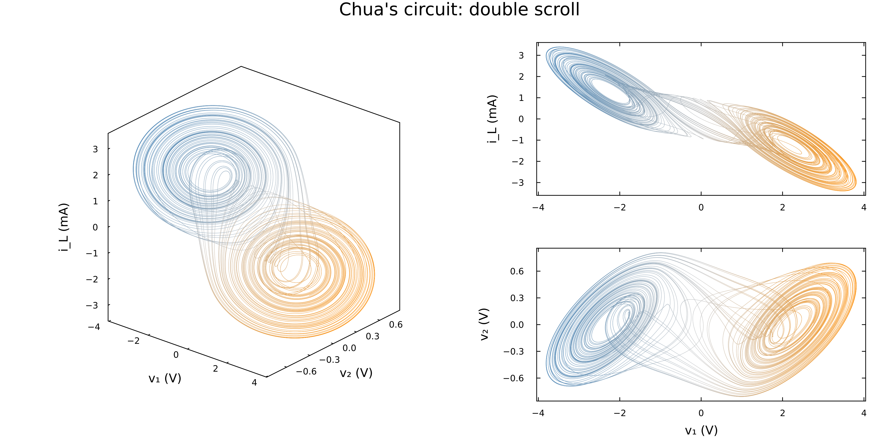

# Chua's Circuit with AlgebraicDynamics.jl

In my graduate dynamical systems course at UCR I was introduced to Chua's circuit, a three-dimensional dynamical system. While reading about AlgebraicJulia and modeling dynamical systems as a composition problem, I wanted to revisit Chua's circuit to model it as a directed and undirected wiring diagram. This allowed me to use AlgebraicDynamics to simulate the compositional model and verify the vector fields against the circuit's equations. The [Lotka-Volterra Three Ways](https://algebraicjulia.github.io/AlgebraicDynamics.jl/dev/examples/Lotka-Volterra) example in the AlgebraicDynamics.jl documentation was a huge help with modeling the circuit.

## What is Chua's Circuit

*This figure is a diagram of Chua's Circuit*

The equations for Chua's Circuit are:

$$
\begin{aligned}
    \dot{v}_{C_1}&=\frac{1}{C_1}\bigg[\frac{1}{R}(v_{C_2}-v_{C_1})-g(v_{C_1})\bigg]\\
        \dot{v}_{C_2}&=\frac{1}{C_2}\bigg[\frac{1}{R}(v_{C_1}-v_{C_2})+i_L\bigg]\\
        \dot{i}_{L}&=-\frac{1}{L}v_{C_2}
\end{aligned}
$$

The nonlinear Chua's diode is a piecewise-linear nonlinear resistor:

$$
g(v) = m_0 v + \tfrac{1}{2}(m_1 - m_0)\left(|v + B_p| - |v - B_p|\right)
$$

The variables are the voltages of the capacitors and the current of the inductor.

To implement the nonlinear diode and circuit components, I used the Chua's circuit devoloped by Kennedy.

## How I did the Compositional Modeling 

To solve the equations I expressed the dynamical system as a composition of systems, allowing me to solve them with the AlgebraicDynamics package. There are two different compositional models I did, the directed model and the undirected one. For the directed model, I took the three different states and used the dynamical equations to inform how the input/outputwise are wired. The compositional model ends up being a composition of three continuous machines, where each machine represents an individual equation. 

*The Directed Compositional Model for Chua's Circuit*

On the other hand, the undirected model works with resource sharers. When looking at the undirected compositional model, there is no $i_L$ displayed. That is because the inductor's current is not a resource that is getting shared between composed systems; it is purely internal. The inductor has two states, $i_L$ and $v_{C_2}$, but only one port sharing the $v_{C_2}$ resource. In the code, the `[1]` in `ContinuousResourceSharer{Float64}(1, 2, dotv2iL, [1])` indicates the first state, $v_{C_2}$, is being shared.

*The Undirected Compositional Model for Chua's Circuit*

## The Results

I used Claude to assist me with plotting the results. I ran three cases, simulating the system with the directed compositional model, the undirected compositional model, and directly via the circuit equations. For all three cases, the plots exhibited the key double-scroll attractor present in the Kennedy paper. However, I assumed the inductor's resistance is 0. In the graphics you can see the full 3D model, as well as 2D projected views.

*The simulated data of the Directed Compositional Model*

*The simulated data of the Undirected Compositional Model*

*The simulated data directly via the circuit equations*

While looking at these pictures, you may notice that the inner parts of the loops look slightly off. To make sure it wasn't an issue with my modeling I used the ODE calculated directly via the equations as a reference and compared the endpoints. Since this is a chaotic dynamical system, a small modeling error should result in drastically different endpoints. What I saw for the directed model is that the max relative distance between the two models was 0. For the undirected model, the max relative distance was `7.133358511643697e-10` with the `reltol=1e-10, abstol=1e-14` parameters. When working with a smaller tolerance, namely `reltol=1e-12, abstol=1e-16`, the max relative distance was `6.721528952024331e-12`. So what ends up happening is slightly different calculations compound, causing the finer details of the graphs to look completely different, which is exactly what you would expect from a chaotic dynamical system.

## Some References I Used While Making This 
 
1. M. P. Kennedy. ABC (Adventures in Bifurcations and Chaos): A program for studying chaos. *Journal of the Franklin Institute*, 1994. [doi:10.1016/0016-0032(94)90084-1](https://doi.org/10.1016/0016-0032(94)90084-1)
2. S. Libkind, A. Baas, E. Patterson, J. Fairbanks. Operadic modeling of dynamical systems: Mathematics and computation. *Proceedings of ACT 2021*, EPTCS 372, 192–206, 2022. [doi:10.4204/EPTCS.372.14](https://doi.org/10.4204/EPTCS.372.14)
3. B. Fong, D. I. Spivak. *An Invitation to Applied Category Theory: Seven Sketches in Compositionality*. Cambridge University Press, 2019.
4. [AlgebraicDynamics.jl](https://github.com/AlgebraicJulia/AlgebraicDynamics.jl)

